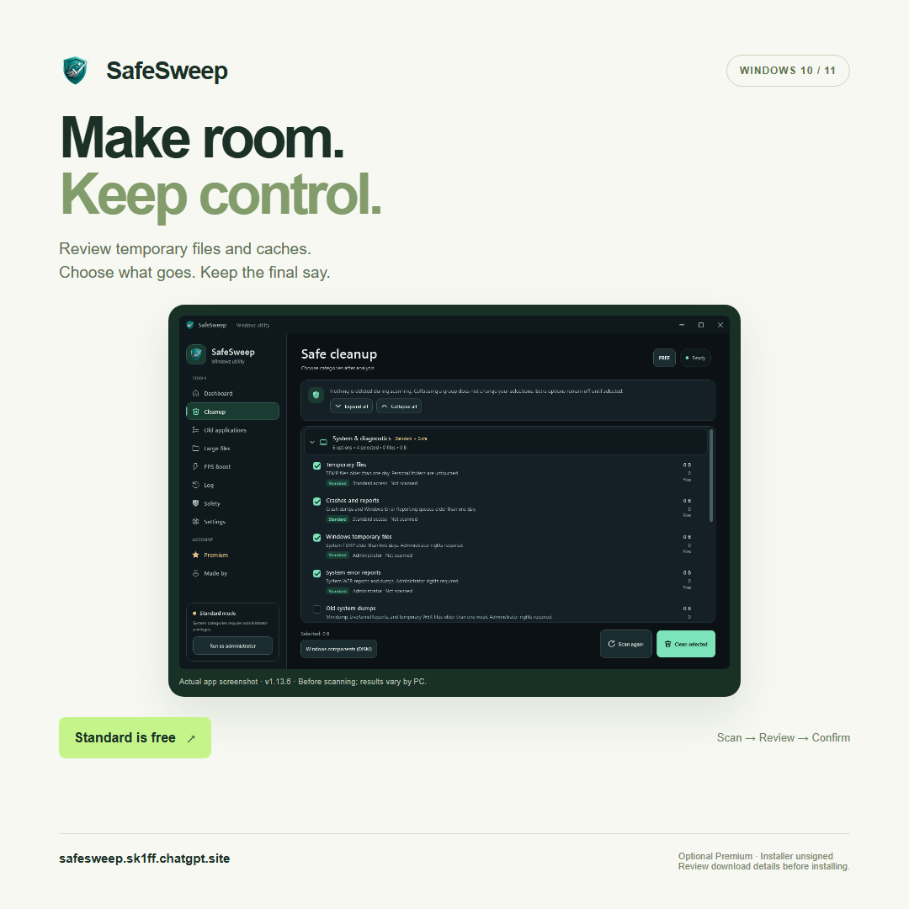

# SafeSweep promotion images

SafeSweep is a Windows 10/11 x64 disk-cleanup app. Standard cleanup is free, with optional paid Premium tools. The app scans supported temporary and cache locations, lets the user review the categories, and requires confirmation before cleanup.

**Official download details:** https://safesweep.sk1ff.chatgpt.site/download

The installer is currently unsigned. Review the file information and Windows warnings before installing; keep Windows Security enabled.

## Images

- [Portrait — 1080 × 1350 PNG](SafeSweep-promo-portrait.png)
- [Square — 1080 × 1080 PNG](SafeSweep-promo-square.png)

Both graphics use an actual app screenshot from v1.13.6, before scanning. That version label is visible in the image. The current public release is v1.13.11. Screenshots and graphics do not promise an amount of recovered disk space or an FPS increase.

## Short description

SafeSweep helps Windows users review temporary files and caches before cleaning. Scan, review, choose, and confirm. Standard cleanup is free; Premium tools are optional. Personal folders are excluded from automatic cleanup. Windows 10/11 x64; installer currently unsigned.

## Suggested short post

Windows drive getting full? SafeSweep lets you scan, review, and confirm before cleanup. Standard is free; Premium is optional.

Unsigned installer—details and download:
https://safesweep.sk1ff.chatgpt.site/download

## Contact

- Website: https://safesweep.sk1ff.chatgpt.site/
- Email: mironantonenko2011@gmail.com
- Developer: Miron Antonenko

These are maker-created promotional materials, not independent reviews or endorsements.
